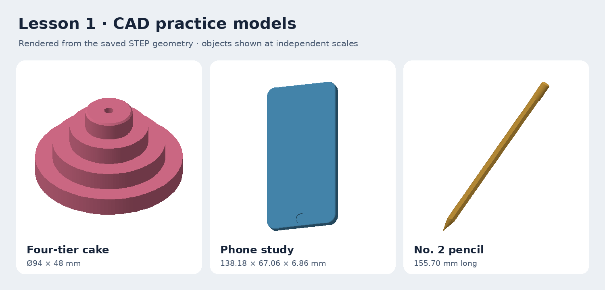

# CAD Magic

**Work in progress.** An independent learning project that turns CAD exercises into checked models and a reusable [agent skill](skills/cad-magic/SKILL.md).

Good CAD can look like magic: change a dimension and the rest of the part follows. The point of this project is to make the constraints and choices behind that trick explicit.

## Lesson 1: Introduction to SolidWorks

[Notes, editable CadQuery source, and STEP models](lessons/01/README.md). The original lesson uses SolidWorks; these practice models were built in CadQuery.



To rebuild and check the models in a Python environment:

```sh
python -m pip install -r requirements.txt
python lessons/01/lesson_01_models.py
```

## Credit

Based on [How to CAD Almost Anything (RES.16-002, MIT IAP 2024)](https://ocw.mit.edu/courses/res-16-002-how-to-cad-almost-anything-january-iap-2024/), taught by **Andy Eskenazi** and made available by **MIT OpenCourseWare**. See the [instructor's original workshop repository](https://github.com/andyeske/How-to-CAD-Almost-Anything) for the slides, recordings, and original SolidWorks files. This is not an official MIT course repository and does not redistribute the original materials.
