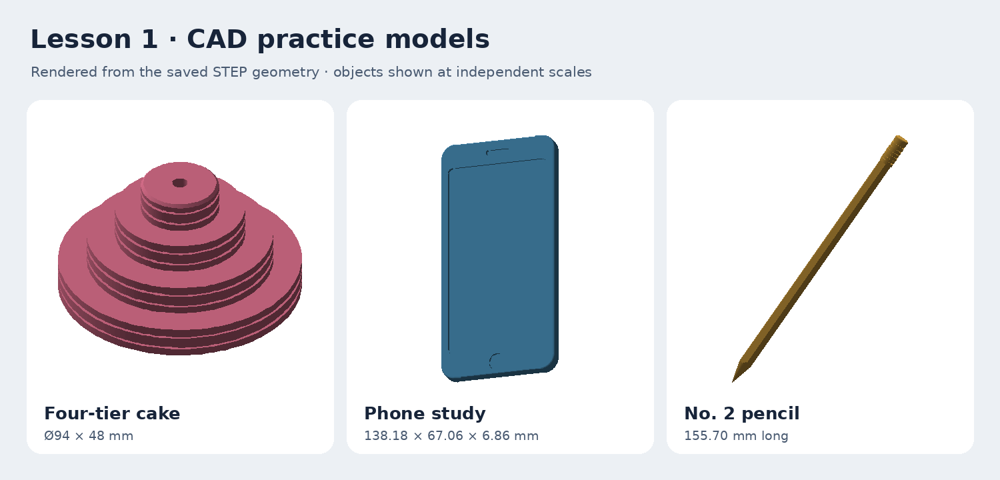

# Lesson 1: Introduction to SolidWorks

MIT IAP 2024 · RES.16-002, *How to CAD Almost Anything* · Andy Eskenazi · January 16, 2024

I reviewed the Session 1 outline and slides for the original SolidWorks track. I then built the exercises in CadQuery rather than SolidWorks. I did not review the recording or test a print.

## What I learned

- **Choose the plane and anchor the sketch before building the solid.** A sketch starts as 2D geometry. The plane gives it orientation; linking features to the origin or a centerline gives them a stable reference. Construction geometry helps position and align things without becoming part of the solid profile.
- **Dimensions tell it how big; relations tell it how to behave.** Smart Dimension supplies values, while relations such as coincident, concentric, or horizontal express how geometry should stay connected or aligned. A fully defined sketch has no unintended freedom to move or resize. For stacked circles, a shared center plus separate diameter dimensions expresses the design better than just fixing circles where I happened to draw them.
- **Build from major volumes to smaller details.** Extruded Boss/Base adds volume from a profile; Extruded Cut removes it. A fillet rounds an edge, while a chamfer bevels it. For the cake, I'd start with the largest tier, add smaller concentric tiers, then experiment with cuts and edge treatments. That's my proposed feature order, not a reconstruction of the instructor's file.
- **The model should survive an edit.** The lesson covers editing both sketches and features after creation. My practical check would be to change a tier diameter, rebuild, and verify that the tiers stay centered and downstream details still work. Appearance and material are separate: making the cake pink doesn't change its geometry or the density used for mass estimates.

## Course exercises

- **Cake (slide 9):** Make at least four tiers and use several of the new commands. This is the open-ended exercise: design something while practicing the tool vocabulary.
- **iPhone 6 (slide 10):** Work from a picture and given overall dimensions (5.44 × 2.64 × 0.27 in). This is visual reverse engineering: the image suggests shapes, but it doesn't establish every radius or detail.
- **#2 pencil (slide 11):** Model from the supplied engineering drawing. Unlike the phone exercise, the drawing is the source of dimensions rather than a picture to estimate from.

## Practice results

- [Cake](lesson-01-cake.step): four tiers, top chamfer and blind cut. Changing the second tier from 72 to 68 mm kept it centered on both axes, verified from the rebuilt solid's cross-section.
- [Phone](lesson-01-phone.step): 67.056 × 138.176 × 6.858 mm, matching the slide's envelope. Corner radii and button recess are approximations.
- [Pencil](lesson-01-pencil.step): 155.702 mm long, with a hexagonal barrel, tapered point and rounded eraser end. I used the drawing's .14 in radius, which gives .2425 in across the hex flats rather than the separately marked .25 in. The ferrule and graphite details are simplified.

The detail pass added two recessed frosting bands per tier, a recessed phone screen and earpiece, and six grooves around the pencil ferrule. These are modeled cuts, not painted lines. The STEP checks probe one cut and adjacent retained material on each model.

## Verification and limits

All three reopened from STEP as single valid solids and retained their checked overall dimensions. The STEP files contain geometry; the Python source contains the editable parameters.

## Artifacts and rebuild

[Editable source](lesson_01_models.py)

After installing the repository requirements, run `python lessons/01/lesson_01_models.py` from the repository root.

## Sources

- [MIT OpenCourseWare course](https://ocw.mit.edu/courses/res-16-002-how-to-cad-almost-anything-january-iap-2024/)
- [Instructor's Session 1 outline](https://github.com/andyeske/How-to-CAD-Almost-Anything#S1)
- [Session 1 slides](https://github.com/andyeske/How-to-CAD-Almost-Anything/blob/main/Session%20Files/Session%201/Session%201.pdf), especially slides 2 and 8–11
- [Session files, including the pencil drawing](https://github.com/andyeske/How-to-CAD-Almost-Anything/tree/main/Session%20Files/Session%201)
- [Session recording](https://www.youtube.com/watch?v=XCfxQDCIZr0) (reference; not reviewed)
