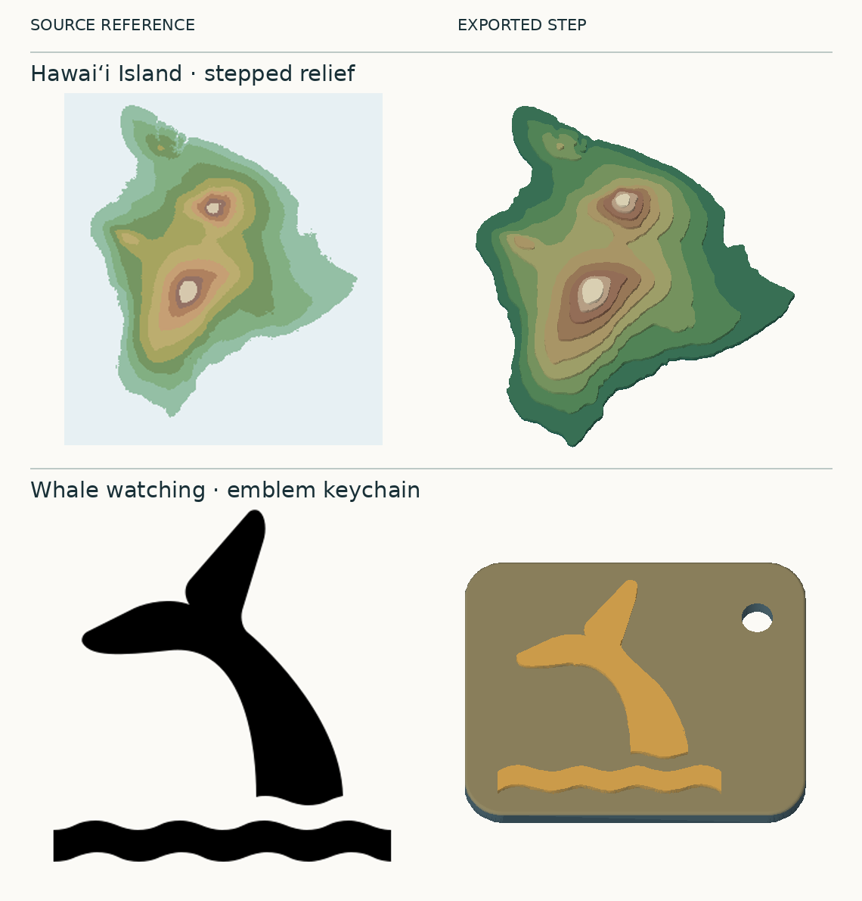

# Lesson 2: Splines and Sketch Pictures

MIT IAP 2024 · RES.16-002, *How to CAD Almost Anything* · Andy Eskenazi · January 17, 2024

I reviewed the Session 2 outline and slides for the original SolidWorks track, then practiced in CadQuery. I did not review the recording or test a print.

## What I learned

A sketch picture is evidence, not decoration. Start by deciding what must survive the translation: two separate summits and a lower saddle on Hawaiʻi; the emblem's internal shapes as well as its outline on the keychain. Check the final STEP against that evidence, not just against the code that built it.

## Course exercises

On slide 5, the Big Island's coastline and nested elevation lines become a stepped relief. Slide 6 turns the Panda Express logo into a keychain: the panda, lettering, and contrast remain legible, and the loop sits outside the main design. The workshop outline permits a logo of your choice. These models use independently sourced reference material rather than redistributing the instructor's artwork.

## Practice results

- **Hawaiʻi Island:** The hooked northwest coast and long southern cape establish orientation. Nine elevation bands separate Mauna Kea from Mauna Loa; the saddle between them matters as much as the summits. The reference panel colors the original, unsmoothed elevation raster. The model fits periodic splines to smoothed contours; equal-thickness steps exaggerate height. [Data, attribution, and calibration](terrain-source.md).
- **Whale-watching keychain:** I chose a whale-tail map pictogram instead of the instructor's panda. Its asymmetric flukes and the gap above the waves carry the image. The attachment point is a functional addition, not part of the source emblem. [Reference artwork](keychain-reference.svg) · [artwork license](keychain-reference-LICENSE.txt).



## Verification and limits

The first attempt checked valid solids but used a self-generated island outline and a blank tag. Those checks could not establish fidelity. This revision retains the STEP checks and compares defining features against independent source media. The nine horizontal sections of the reimported island overlap their source masks by 88.4–98.3% (intersection over union). Both named summits reach the highest tier; their saddle does not. The 20 m band approximates the coastline. The whale relief matches 94.6% of the source mask by intersection over union; its tail and water remain distinct and the 5 mm bore clears the emblem. Neither part was printed.

## Artifacts and rebuild

[Terrain STEP](terrain.step) · [Keychain STEP](keychain.step) · [Build and checks](models.py) · [Comparison renderer](render.py)

After installing the repository requirements, run from the repository root:

```sh
python lessons/02/models.py
python lessons/02/render.py
```

## Sources

- [MIT OpenCourseWare course](https://ocw.mit.edu/courses/res-16-002-how-to-cad-almost-anything-january-iap-2024/)
- [Instructor's Session 2 outline](https://github.com/andyeske/How-to-CAD-Almost-Anything#S2)
- [Session 2 slides](https://github.com/andyeske/How-to-CAD-Almost-Anything/blob/main/Session%20Files/Session%202/Session%202.pdf), especially slides 2 and 4–6
- [Session recording](https://www.youtube.com/watch?v=4fcvDSAFNGo) (reference; not reviewed)
- [NPS NPMap whale-viewing symbol, pinned source](https://github.com/nationalparkservice/symbol-library/blob/27e97208c860366ab9d78dfe594a778c411661fb/src/standalone/whale-viewing-black-30.svg); artwork and derivative trace retain the [BSD notice](keychain-reference-LICENSE.txt), © 2013 Mapbox.
