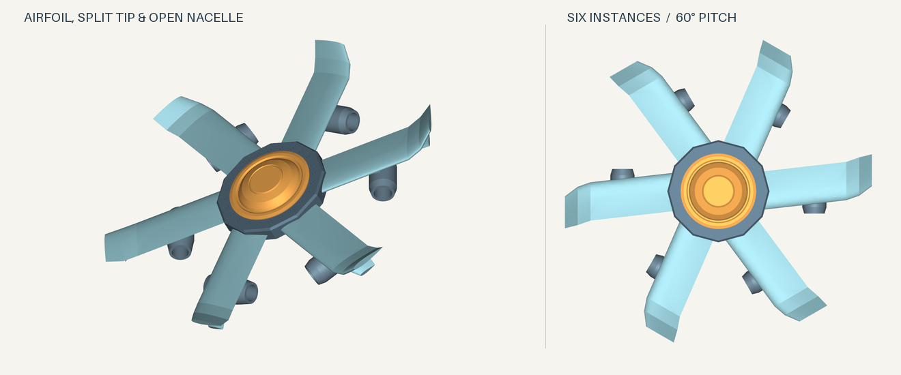
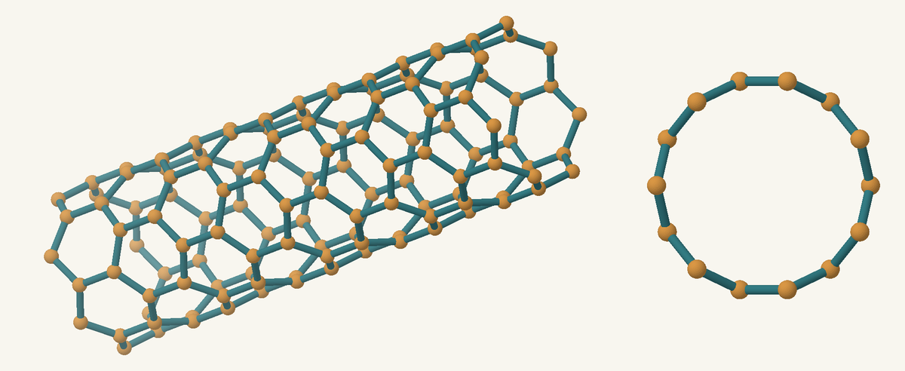

# 03 · Revolves, planes and patterns

MIT IAP 2024 · Andy Eskenazi · Session 3. Based on the instructor’s outline and slides; implemented in CadQuery rather than SolidWorks.

## What I learned

A repeat count is not a design intent by itself. On the spinner, another wing changes the angular spacing, not the wing or the outer radius. On the nanotube, another column at fixed cell pitch makes a wider tube. Decide which dimension is allowed to change before choosing how to pattern the geometry. See the [skill’s pattern guide](../../skills/cad-magic/references/patterns.md).

## Course exercises

Session 3 introduces revolve, mirror, circular pattern and construction planes through fidget spinners and carbon nanotubes. Our spinner follows the aircraft-inspired example on slide 5; the tube follows the open ball-and-stick network on slide 6.

## Practice results

The complete wing, including its engine and split tip, rotates as one feature. The hub crown and hollow engine use different revolution axes.

The tube uses shared joints where the last column meets the first. Its open centre is visible in the end view.

## Verification and limits

The six- and five-wing STEP imports each contain one valid solid; their tip radius is 49.382 mm and every engine duct clears a 4.2 mm probe. This is a fused exterior study, not a tested bearing assembly. The tube has 56 six-edge cells: adding two columns preserves height, while adding two axial rows preserves bore clearance. Its intersecting balls and rods form a connected network, not a fused printable solid. No physical or molecular simulation was performed.

## Artifacts and rebuild

[Spinner source, STEP, commands and measurements](spinner/NOTES.md) · [Nanotube source, STEP, commands and measurements](nanotube/notes.md) · [Independent dial and spinner trials](../../trials/03/README.md)

## Sources

[MIT OpenCourseWare course](https://ocw.mit.edu/courses/res-16-002-how-to-cad-almost-anything-january-iap-2024/) · [Instructor’s outline](https://github.com/andyeske/How-to-CAD-Almost-Anything#S3) · [Session 3 slides](https://github.com/andyeske/How-to-CAD-Almost-Anything/blob/main/Session%20Files/Session%203/Session%203.pdf)
