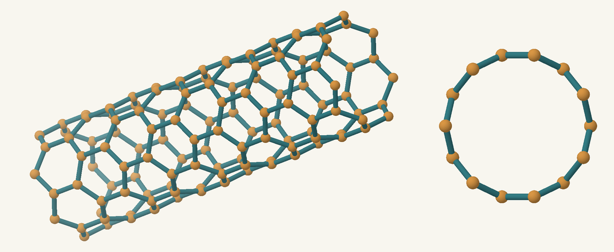

# Open honeycomb tube

[Session 3, slide 6](https://github.com/andyeske/How-to-CAD-Almost-Anything/blob/main/Session%20Files/Session%203/Session%203.pdf) shows a cylindrical ball-and-stick honeycomb with open ends, not a perforated solid pipe. The [instructor’s outline](https://github.com/andyeske/How-to-CAD-Almost-Anything#S3) calls for circular and linear patterns and planes. The interpretation here uses staggered hexagon centres on an unrolled sheet and maps their corners onto radial planes. It substitutes chosen millimetre dimensions for the undimensioned reference. It does not model molecular bond energetics or claim an exact chirality match.

Wrap shared corner indices modulo the full circumference **before** creating nodes and bonds. Otherwise a seam can look closed while hiding duplicate nodes or rods. Separate balls and cylinders intentionally overlap at their joints; the STEP is a multi-solid illustration, **not** a fused printable part. Gold/teal colors distinguish the roles in the render; they do not encode different elements.



From the repository root, with its requirements installed:

```sh
python lessons/03/nanotube/model.py
python lessons/03/nanotube/render.py
```

[Editable model and export checks](model.py) · [STEP](nanotube.step) · [STEP renderer](render.py)

The checker reconstructs the network from spherical solid centres and cylinder end-face centres in each reimported STEP. Every bond end lies within 0.000001 mm of a joint. It checks one connected graph without repeated edges, two-valent rim nodes and three-valent remaining nodes, and the complete number of six-edge cycles including the seam. The diameter below is a conservative clearance bound from the imported rod and joint positions and the specified rod and ball radii.

| Circumferential sectors × axial rows | Nodes / bonds | Hexagonal cells | Height (mm) | Clear axial diameter ≥ (mm) |
| --- | ---: | ---: | ---: | ---: |
| 7 × 8, published | 126 / 182 | 56 | 38.540 | 10.538 |
| 9 × 8, wider | 162 / 234 | 72 | 38.540 | 13.846 |
| 7 × 10, longer | 154 / 224 | 70 | 47.540 | 10.538 |

Increasing the sector count preserves axial height, not tube radius. Increasing the row count preserves radius, not height. Straight chords between wrapped points are slightly shorter than sheet distances: the default bond lengths are 2.981–3.000 mm for a nominal 3 mm unrolled bond length. No physical article was made.
