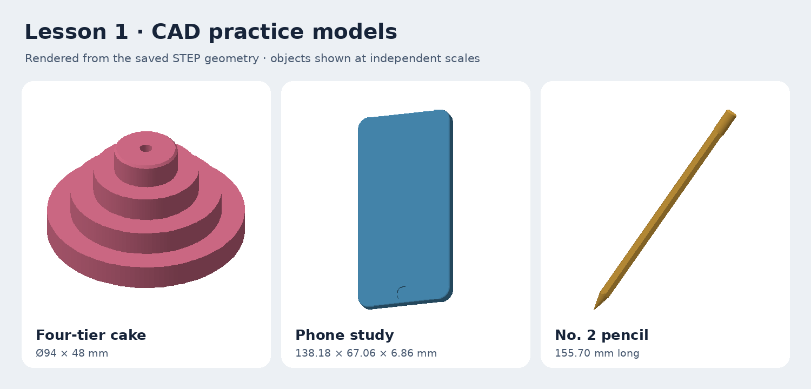
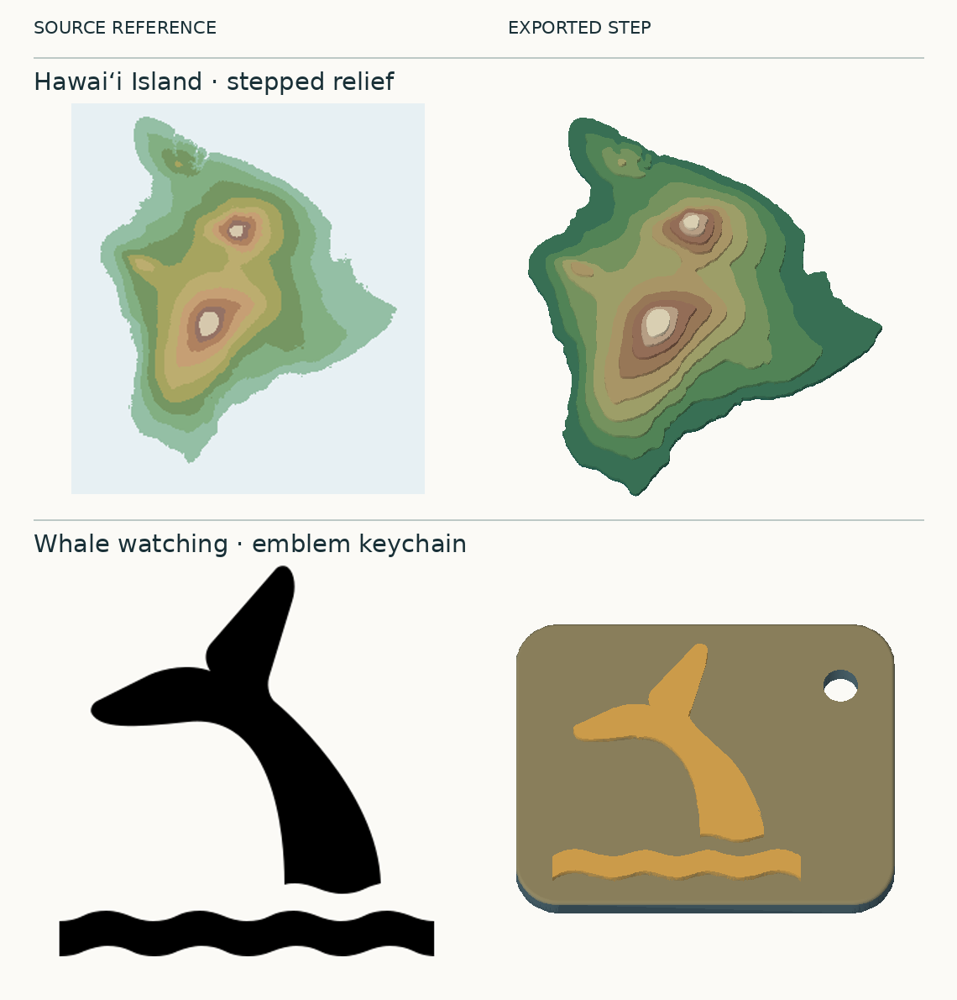

# Lesson index

Each lesson records what was built, what was verified, and which technique became part of the [CAD Magic skill](../skills/cad-magic/SKILL.md).

- [01 · Introduction to SolidWorks](01/README.md) — Built a four-tier cake, phone study, and pencil. All three STEP exports reopened as valid solids with the expected overall dimensions; resizing the cake's second tier preserved its center. **Skill outcome:** anchor geometry to stable references and test design intent with a real edit.

  

- [02 · Splines and Sketch Pictures](02/README.md) — Rebuilt Hawaiʻi Island from elevation data and a whale-watching keychain from a map pictogram. **Skill outcome:** preserve the landmarks and negative space that identify a subject, then compare a render from the STEP with the independent source—not with a picture generated by the model.

  

These are CAD checks, not physical print tests.
