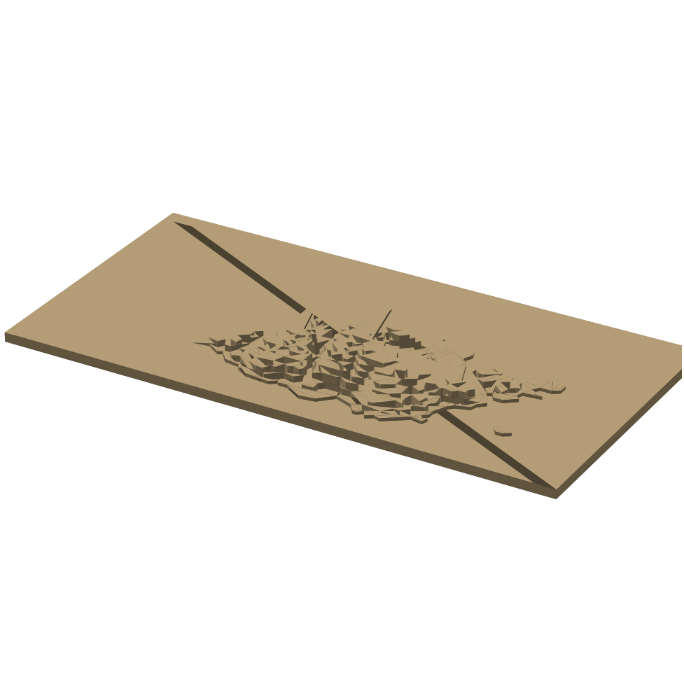
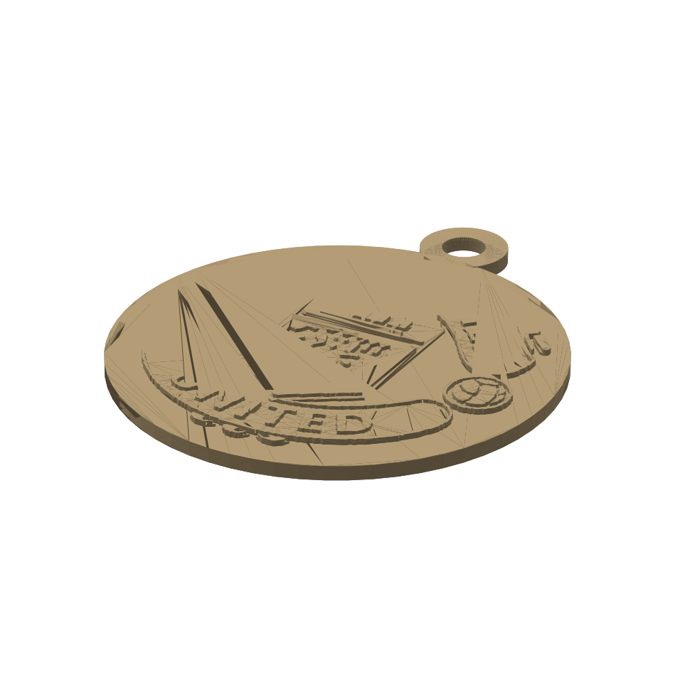

# Terra 6.1 · Lesson 2 transfer assessment

**Neither model passes.** I reopened both submitted STEP files in a separate CadQuery process and inspected the four submitted views. Envelope dimensions pass; neither import is valid.

- **Madeira:** 18 solids, 120 × 60.73 × 7.85 mm. Relief readability fails: a long diagonal crosses the sea plate. Central high ground and descending valleys cannot be distinguished confidently; coastline and peninsula fidelity remain unverified rather than inferred from the tracing script.
- **Manchester United:** 72 solids, 60 × 70 × 2.8 mm. Partial recognition: round footballs and parts of the banners remain visible in the oblique view, but the lettering, ship and devil do not read together as the emblem. The loop visibly clears the motif; the student reports a clear bore, not proof of a connected keychain.
- **Untested:** parameter variation, slicer behavior and physical prints. The submitted editable scripts and candid failure report are useful evidence, not passing parts.

## What to teach next

The student used external references and caught the failures. Detection transferred; recovery did not. For a new trial, teach an earlier checkpoint: trace one representative region with an internal hole, extrude it, unite it with the base and reopen it as one valid solid before repeating the technique across the image. Separately judge unpainted features at the intended size beside the reference. A correct bounding box cannot answer either question. This is a proposed intervention, not a demonstrated fix or a general verdict on the model.

[Student report and rebuild instructions](submission/README.md) · [Frozen criteria and input sources](../README.md) · [Submitted measurements](submission/results/verification.json). To rebuild, place the two referenced inputs under this trial's inputs/ using the filenames in the student report. The third-party reference raster is not redistributed.
