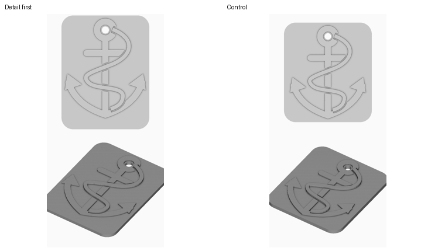

# V2: Does building the hardest detail first improve the finished emblem?

**No visible advantage in this pair.** Both Astra 6.2 runs preserved the anchor silhouette and the continuous rope passing in front of its shank. Both delivered a single valid 60 mm part. Do not add a mandatory prototyping step to the skill on this evidence.

Both students received the [same reference](reference.svg), [brief](brief.md) and skill revision 0357860, in fresh contexts without peer work. Only the detail-first arm received the [additional instruction](intervention.md); it produced a [test piece](detail-first/submission/coupon.step). See the [criteria fixed before dispatch](protocol.md).

**Visual review:** A reviewer saw anonymous top and oblique views rendered from the final STEPs with the same camera settings and material. Neither rope broke or reversed order at a crossing. Both final builds leave a margin around the eye. The detail-first version leaves more space below the anchor than above, closer to the reference; the control is more evenly centered. This minor framing difference does not affect crossing readability.

**Independent geometry checks:** Both exports reopened as one valid solid, width 60.000 mm. Bore diameters from cylindrical faces: 4.8 mm detail-first, 4.4 mm control. A coaxial probe 0.02 mm smaller in diameter crossed each part with zero intersection volume. No physical strength, printability or ring-fit tests.

**Decision:** The coupon demonstrates execution of the instruction, not improvement over control. One pair and one relatively simple motif cannot establish equivalence or disprove its usefulness for more fragile details. No skill revision adopted.

[Detail-first source and evidence](detail-first/submission/evidence.md) · [Control source and evidence](control/submission/evidence.md) · [Version ledger](../comparison.md)
