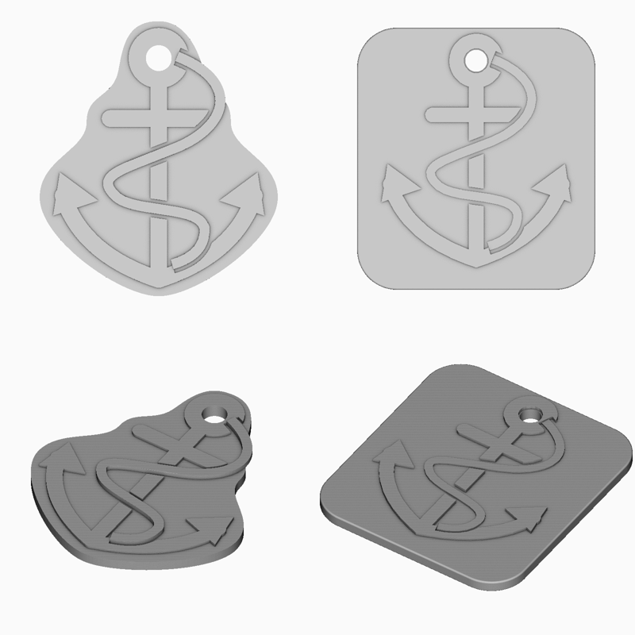

# Sol 6.2 replication: anchor and rope

Both runs pass. The same frozen skill (0357860), [brief, intervention and judging protocol](../v2.2026-11-21.astra+6.2/) as Astra were used in separate fresh contexts. Only the detail-first student was asked to prototype a feature.

The blind reviewer traced the rope continuously across both interruptions in each shank. Both anchors match the [reference](reference.svg). The detail-first crossing casts a clearer shadow at an angle; the control relies more on gaps, but its crossing is still legible. The different backing shapes are design choices, not failures.

Independently reopened: each STEP contains one valid solid 60.00 mm wide. The detail-first bore measures 6.50 mm, the control 5.50 mm. A coaxial cylinder 0.02 mm smaller than each bore passed through the entire part with zero intersection volume. No physical print or strength test.

[Detail-first submission and coupon](detail-first/submission/) · [Control submission](control/submission/). Both Sol and Astra met the brief without the extra instruction. This is one subject, not a general model ranking or a test against no skill. No skill change adopted.
