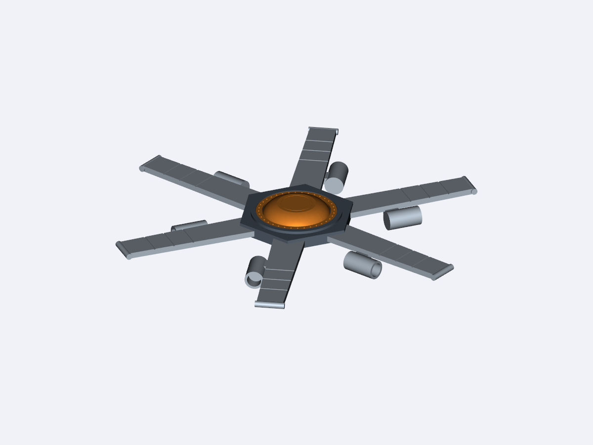
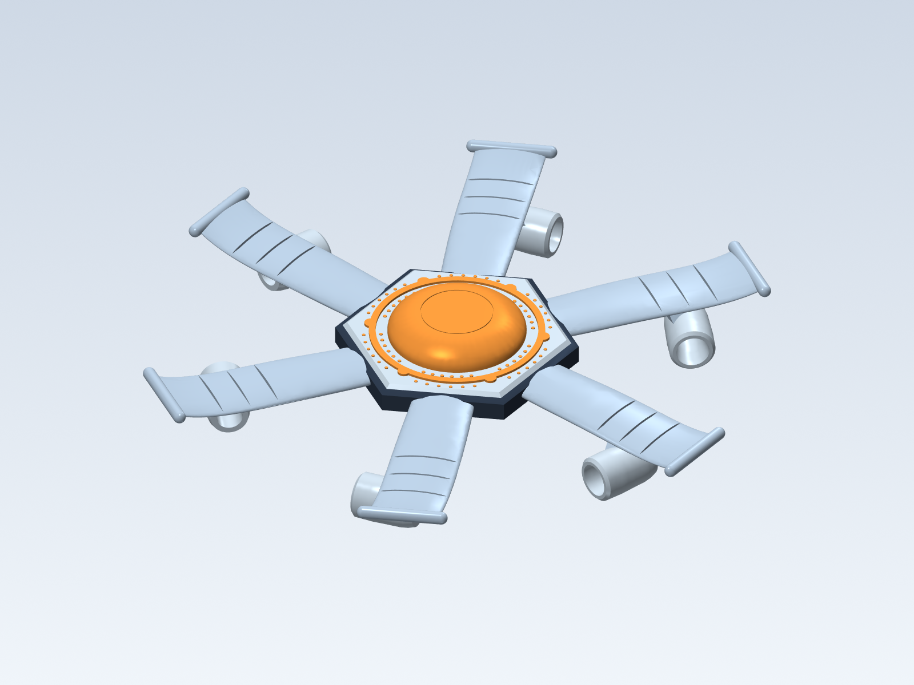

# Lesson 3 trials
- [Editable indexing dial](v1.2026-11-21.terra+6.1/README.md): both the skill-guided and brief-only submissions passed the dimensional checks.
- Spinner exterior: [Sol 6.2](v2.2026-11-21.sol+6.2/) and [Terra 6.1](v2.2026-11-21.terra+6.1/) received the same skill and the right-hand design on [slide 5](https://github.com/andyeske/How-to-CAD-Almost-Anything/blob/main/Session%20Files/Session%203/Session%203.pdf#page=5).

**Blind visual review:** A (Terra) and B (Sol) both captured the six-arm layout, pods and domed centre. B was closer: curved wings, rounded tip bars and hub detailing preserved the aircraft character. A's flat arms are a meaningful shape loss, not a lighting issue. B simplified the hub perimeter and the visible angled pod support. Colour differences are cosmetic. Both exports independently reopened as valid compounds (A: 29 solids, B: 94); neither establishes a working spinner.

**Pending hypothesis, not an adopted skill edit:** a side-profile comparison of a repeated feature might help catch a flat section before it is copied around the hub. Test on an independent subject before adopting. Both runs received the skill, so this comparison cannot isolate its effect.
Both five-wing variants independently rebuilt and reopened.

- [Single-wing attachment comparison, Terra 6.1](v3.2026-11-21.terra+6.1/README.md): both runs recovered engine direction on the crop.

- [V4 · whole-spinner visual scorecard](v4.2026-11-21.terra+6.1/)
