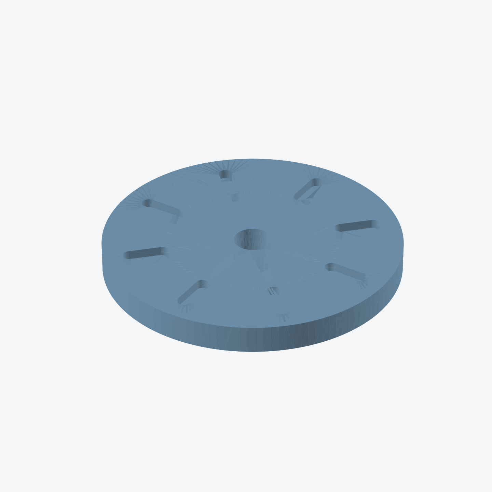
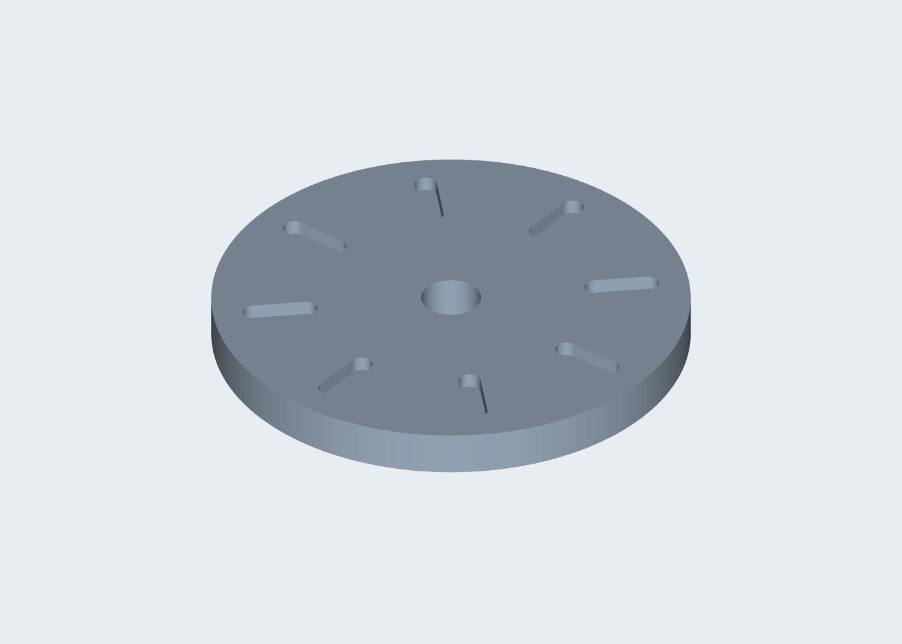

# Lesson 3 transfer trial · indexing dial

**Both Terra 6.1 runs passed.** Each produced an editable dial and two valid STEP exports from the same [brief](brief.md). [Protocol and frozen skill identifiers](protocol.md).

The [independent checker](check.py) reopened all four files. Every dial was one valid 64 × 64 × 6 mm solid with an open central bore. For both repeat counts, slot depth, sampled footprint and orientation matched at every required angle. Eight-slot volume was 18551.255033 mm³; eleven-slot volume was 18382.843533 mm³. Both match the analytic capsule subtraction. Both sources take count as an argument without changing any other dimension.

**Disposition:** no trial-driven skill edit. The lesson supplies evidence for the pattern technique; this pair shows no advantage from supplying the skill on a fully dimensioned radial pattern. It did not test a wrapped seam, physical performance, cost or general model reliability.
