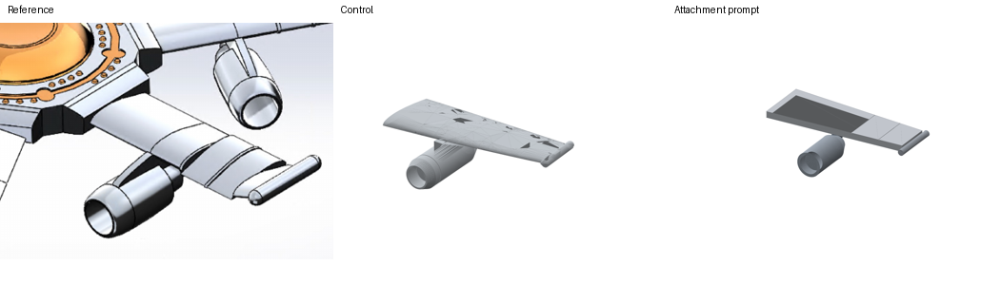

# One-wing attachment trial · Terra 6.1

Two fresh runs received the same [slide 5 crop](reference.png), frozen skill, CAD tools and single-wing brief. Only one received: “Before adding detail, compare where the parts attach and which way they point against the reference.”

The earlier full spinner placed each engine alongside its wing pointing toward the tip: a major reference mismatch despite passing the repeat-count test. On the isolated unit both runs placed the intake below the wing facing across the span. The control shows a clearer support and a more rounded section; neither closely reproduces the reference panels. The close-up and reduced scope both changed since the spinner trial, so the comparison does not isolate why placement improved. No skill change.

Independent STEP reimport: control five valid solids, prompted four. This checks geometry, not physical attachment or manufacturability.

Blind review (A prompted; B control): B was closer overall for wing curvature, intake lip and visible support; A had clearer panel divisions. Exact mount offset cannot be inferred from one view.
