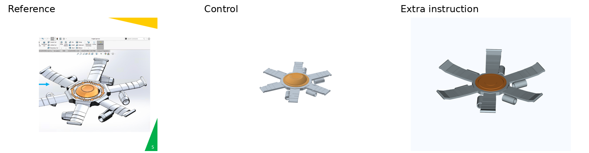

# Whole-spinner visual trial · Terra 6.1

[Protocol](protocol.md) · [scoring guide](../../visual-scoring.md) · [control](control/) · [extra instruction](prompted/)

Blind overall: 3/5 each; reviewer preferred control (Iris) for the raised dome and dotted surround. Prompted (Oak) captured the rising tips better. Both remain recognizable approximations. Scores are ordinal, not averaged.

| Criterion | Control | Prompted |
|---|---|---|
| Shape | 3: slab-like wings, straight pods | 3: better upturn, flat center and tubular pods |
| Proportion | 3: projected hub/span 44% | 3: 34%, against roughly 39% in reference |
| Surface detail | 3: perimeter dots and seams, missing layered surround | 2: seams present, perimeter pattern absent |
| Finish | 3: silver and gold, visible facets | 3: smooth tubes, dark oblique appearance |

Different lighting and cameras limit finish comparison. Occlusion prevents a reliable intake ratio. Independent STEP import: control one valid solid; prompted valid 46-solid compound. Count-only five-arm rebuilds reimported valid (one and 39 solids respectively). Neither proves fitness for manufacture. The prompted student inspected its seed after the first full build: the timing intervention was not faithfully executed. No skill change.

### Comparison with the earlier one-wing control
The blind preference above compares only the two V4 spinners. Compared with the [V3 wing source](../v3.2026-11-21.terra+6.1/control/model.py), the [V4 control](control/model.py) regressed on three defining features: a tapered airfoil became a constant-thickness extrusion; the tapered nacelle ends and front ring groove became a plain bored cylinder; and the intake axis changed from across the wing span to pointing toward the tip. Hub decoration does not compensate for these losses. This comparison identifies what changed, not why the fresh run chose it.

Post-trial orientation assessment (not part of the frozen blind protocol): control 1/5; prompted 1/5. In both model.py files the nacelle cylinder axis runs along the radial wing span instead of across it. Underwing position does not establish correct facing.
